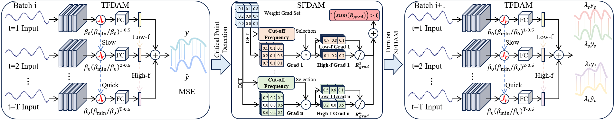

# Spatio-Temporal Spectral Backpropagation for Training Spiking Neural Networks

This is the official code for our paper "Spatio-Temporal Spectral Backpropagation for Training Spiking Neural Networks".

## Abstract

Spiking Neural Networks (SNNs) offer significant advantages in time-series modeling due to their event-driven nature and biological plausibility, yet their training remains challenging. In existing backpropagation algorithms, parameters are deeply coupled within the temporal dimension, hindering the quantification of individual influences and limiting the analytical depth of gradient dynamics and theoretical interpretability. This paper proposes the Spatio-Temporal Spectral Backpropagation (STSBP) framework, which decomposes SNN error propagation in the spatio-temporal frequency domain into a product of four terms: (1) a spatial frequency kernel dependent on network structure and surrogate gradients; (2) a temporal frequency kernel governed by the leakage factor $\beta$; (3) an error spatio-temporal spectrum derived from task errors; and (4) an input signal spectrum. The framework reveals that SNNs prioritize low-frequency components in the spatial domain. In the temporal domain, the learning order is jointly determined by the temporal frequency kernel, the spatial-frequency integral of the error spectrum, and the input signal spectrum. Motivated by these insights, we operationalize the continuous frequency-domain analysis into a discrete training paradigm with our Frequency-LIF model. It features two core modules: the Spatial Frequency Dynamic Adjustment Mechanism (SFDAM) and the Temporal Frequency Dynamic Adjustment Mechanism (TFDAM). Bridging continuous spectra and discrete parameters, SFDAM uses parameter gradient spectra as a proxy to monitor low-frequency dominance, guiding learning from global trends to local details. In the temporal domain, to dynamically evolve from long-term trends to transient events, TFDAM introduces a time-dependent exponential decay strategy, steering the focus from low to high frequencies. Experimental results on eight time-series prediction benchmark datasets demonstrate that Frequency-LIF outperforms current state-of-the-art methods.

## Overall Architecture

The framework of Frequency-LIF comprises two core modules: SFDAM and TFDAM. These modules dynamically regulate learning preference for frequency components across the spatial and temporal frequency domains, respectively.

<p align="center">

</p>

## Datasets

### Eight real-world datasets

* [ETT](https://github.com/zhouhaoyi/ETDataset/tree/main)
* [Traffic, Weather](https://github.com/thuml/Autoformer)
* [Solar-energy](https://github.com/laiguokun/LSTNet)
* [Exchange](https://www.kaggle.com/datasets/giochelavaipiatti/time-series-forecasts-popular-benchmark-datasets/#site-content)

## Usage
Install Pytorch and the necessary dependencies.

```
pip install -r requirements.txt
```

To train a Frequency-LIF model on a dataset, run

```bash
python main.py --model iTransformer --activation Frequency_LIF --data ETTh1 --root_path dataset_address --data_path ETTh1.csv --seq_len 96 --pred_len 96
```

## Citation

If you use this code for your research, please cite our paper:
```

```
